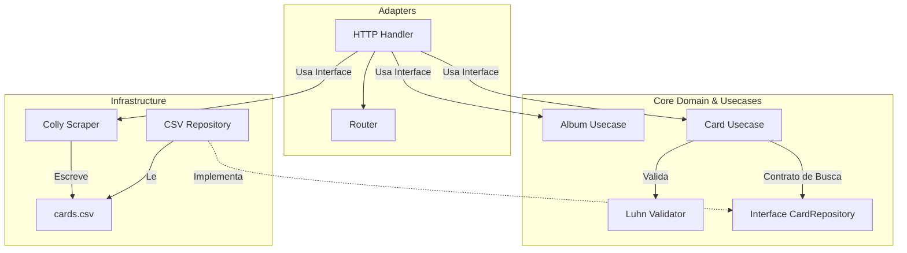

# Validador de Cartões & Scraper de Metadados

Uma API REST desenvolvida em Go para validar números de cartão de crédito usando o Algoritmo de Luhn e consultar informações da bandeira emissora a partir de uma base local em CSV. O projeto inclui um scraper de dados concorrente para alimentar e atualizar a base local.

---

## Arquitetura e Destaques Técnicos

O projeto adota princípios de **Clean Architecture** (Arquitetura Limpa) para manter as camadas isoladas e fáceis de testar.



### Desafios Técnicos Resolvidos:
* **Inversão de Dependência (DIP):** A camada HTTP depende apenas de interfaces locais em vez de implementações concretas dos casos de uso. Da mesma forma, as regras de negócio dependem de interfaces de domínio e não de banco de dados ou arquivos. Isso isola o core da aplicação e permite testes unitários com mocks rápidos.
* **Segregação de Pacotes (Imports Otimizados):** A estrutura de diretórios separa `usecase/album`, `usecase/card` e `infra/scraper`. Dessa forma, componentes leves do domínio (como o validador de cartões) podem ser importados de forma independente, sem carregar bibliotecas externas pesadas (como `colly` ou `gin`) na memória.
* **Scraping Concorrente e Resiliente:** O crawler assíncrono utiliza o framework `colly` e foi projetado para rodar em background. Conta com limites de concorrência, atrasos aleatórios nas requisições e rotação de headers para evitar bloqueios por IP nos sites de origem.
* **Busca Otimizada por Prefixo:** Implementação de um leitor customizado de CSV capaz de identificar a bandeira do cartão buscando correspondências pelo prefixo numérico, funcionando como um banco de dados local veloz e sem dependências externas de SGBDs.

---

## Tecnologias Utilizadas
* **Linguagem:** Go 1.24+
* **Framework Web:** Gin Gonic (Roteamento REST e validação de JSON)
* **Web Scraping:** Colly (Scraping concorrente de páginas HTML)
* **Testes:** Testify (Mocks e assertions estruturadas)
* **Configuração:** GoDotEnv

---

## Como o Projeto Funciona

### Endpoints Disponíveis

* `GET /validate/:number`: Recebe o número de um cartão, executa o Algoritmo de Luhn puramente em Go e retorna um JSON informando se o número é numericamente válido (`true` ou `false`).
* `GET /cards/:number`: Busca no banco de dados local `cards.csv` para encontrar os detalhes emissor do cartão (Nome, Tipo, Categoria e País).
* `POST /scrape`: Inicia a rotina assíncrona de scraping baseada nos parâmetros do arquivo `.env` e atualiza a base `cards.csv`.
* `GET /albums` / `GET /albums/:id` / `POST /albums`: Endpoints CRUD em memória para teste rápido de payload e integridade da arquitetura de adaptadores.

---

## Como Rodar Localmente

### Pré-requisitos
* Ter o [Go 1.24](https://go.dev/dl/) ou superior instalado no seu sistema.

### 1. Clonar o Repositório
```bash
git clone https://github.com/miguelnatantomaz/card-validator-go-rest.git
cd card-validator-go-rest
```

### 2. Configurar as Variáveis de Ambiente
Crie um arquivo `.env` no diretório raiz do projeto:
```env
SCRAPER_URL=[URL_DO_SITE_ALVO]
SCRAPER_PAGES=5
```
*(Você pode copiar o arquivo `.env.example` para servir de base).*

### 3. Instalar as Dependências
```bash
go mod tidy
```

### 4. Compilar e Rodar

**Gerar o Executável:**
```bash
go build -o api.exe cmd/main.go
# Executar:
./api.exe
```

**Rodar Diretamente:**
```bash
go run cmd/main.go
```
O servidor estará ativo em `http://localhost:8080`.

### 5. Executar os Testes Unitários
```bash
go test ./... -v
```

---

## O que Eu Aprendi

Neste projeto, consolidei a aplicação prática dos **princípios SOLID**, principalmente o Princípio de Inversão de Dependência, e aprendi a modelar pacotes em Go para evitar acoplamento e dependências cíclicas de importação. O desenvolvimento do scraper me deu experiência prática em lidar com limites de banda e cabeçalhos de requisição de forma respeitosa com os servidores de terceiros. Na parte de soft skills, a refatoração me ajudou a exercitar planejamento técnico de forma organizada, garantindo que o código permanecesse estável e testável a cada mudança.